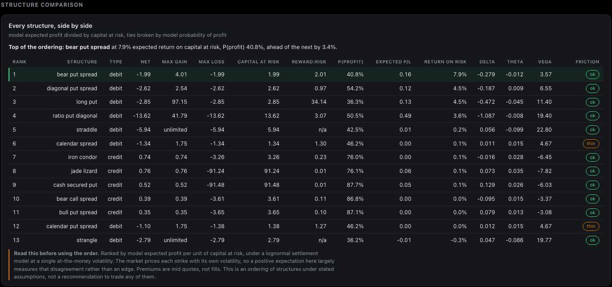
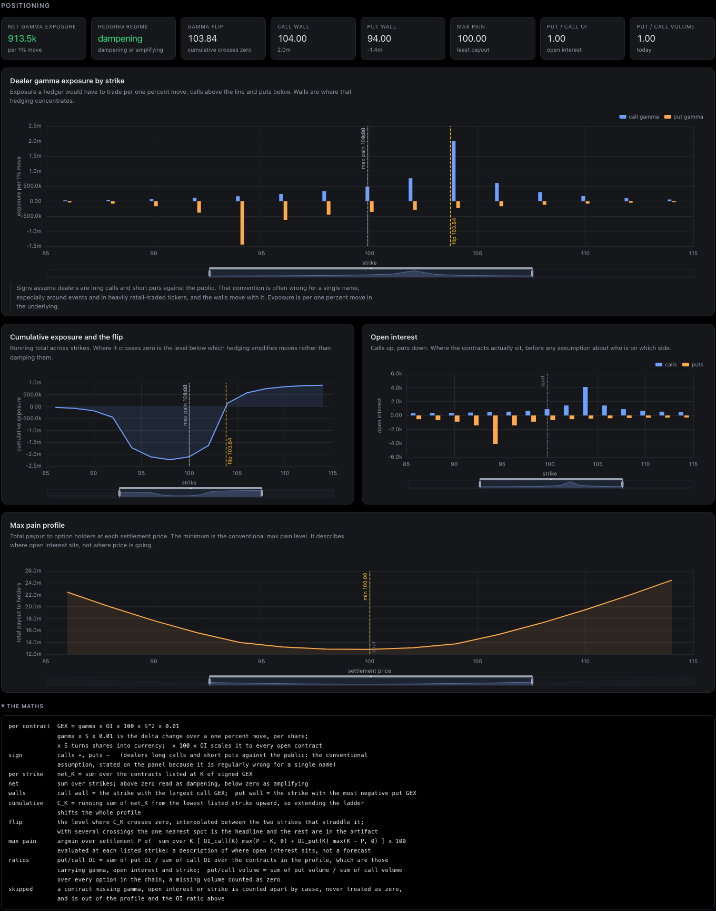
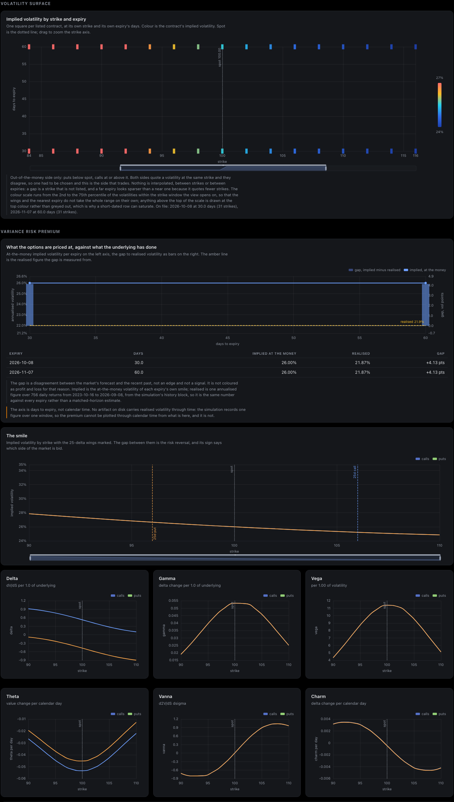
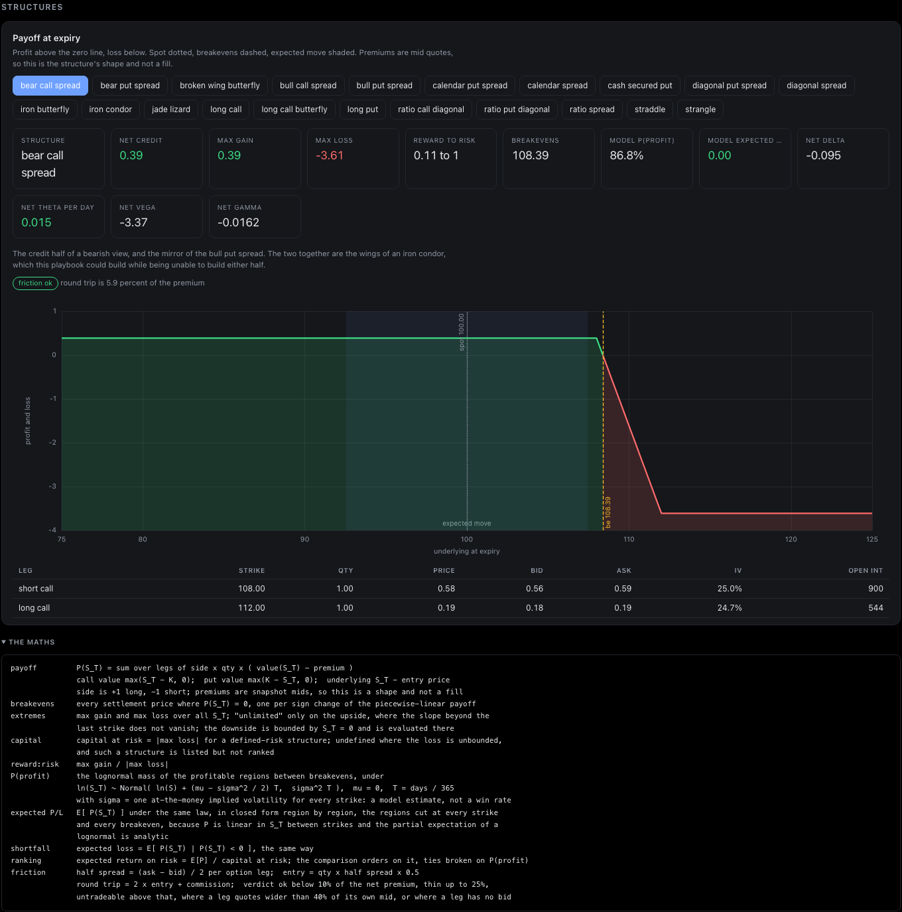
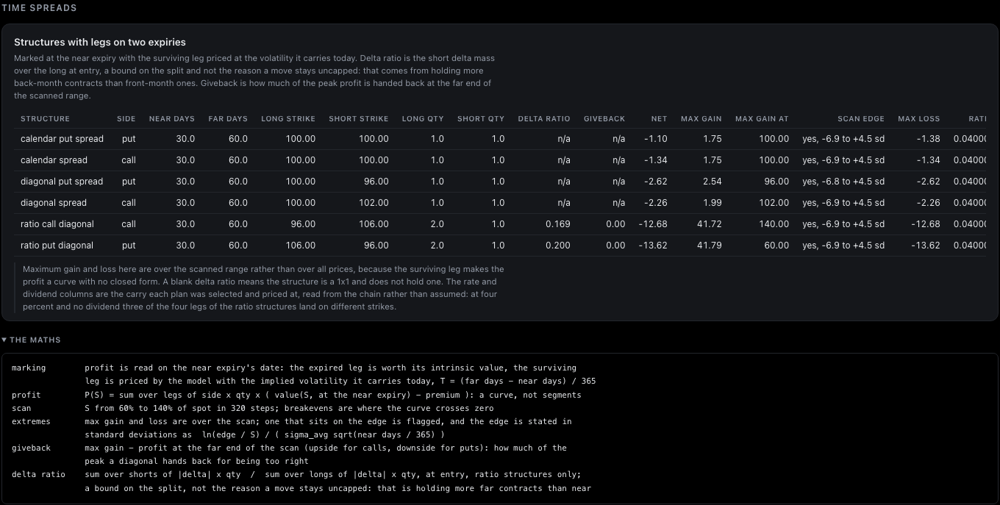
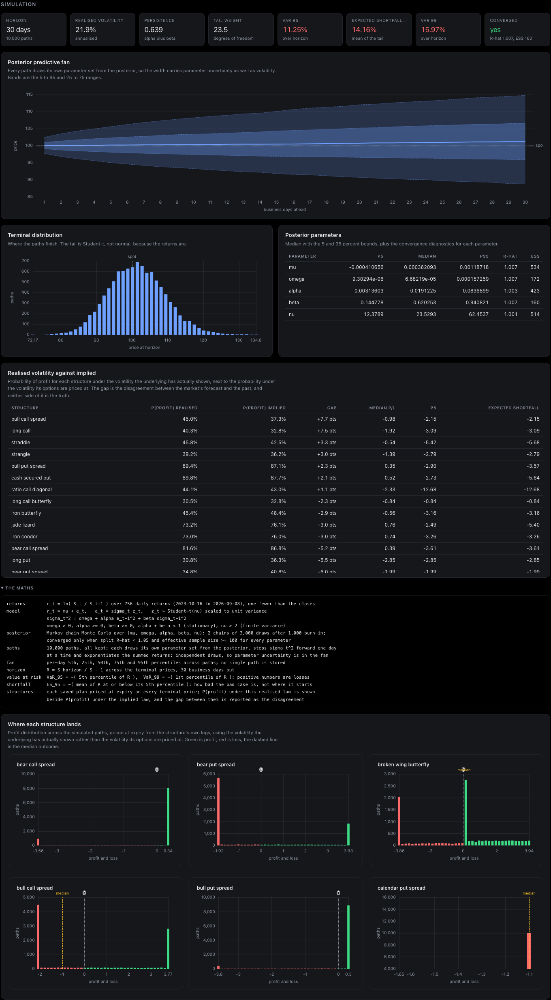
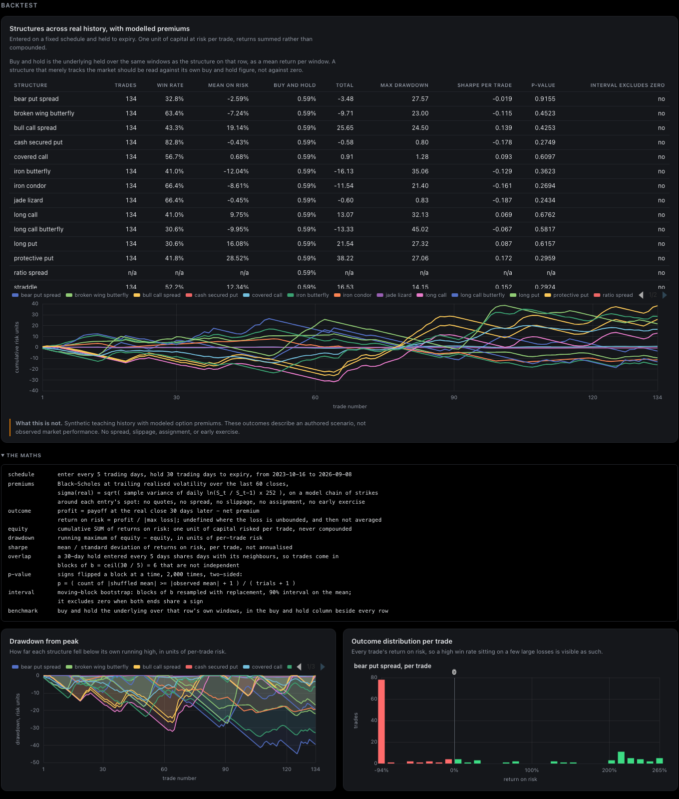
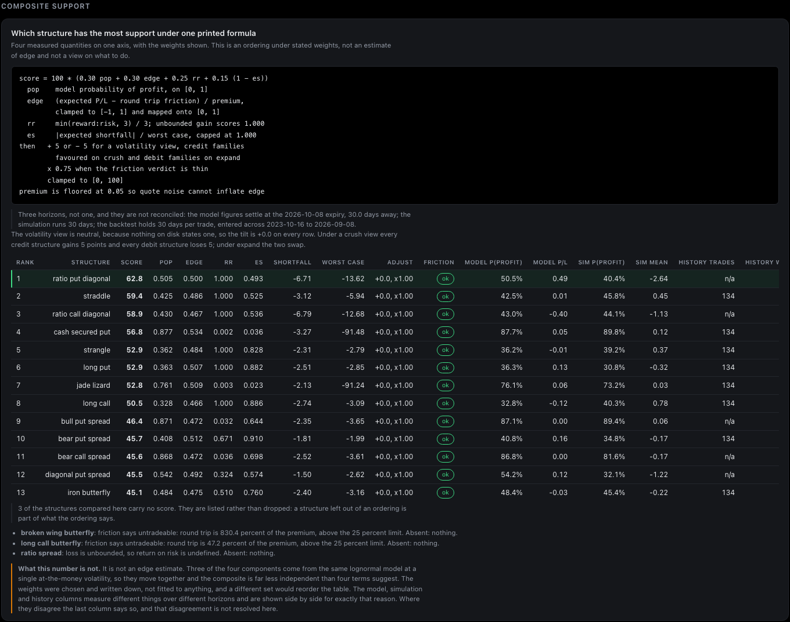
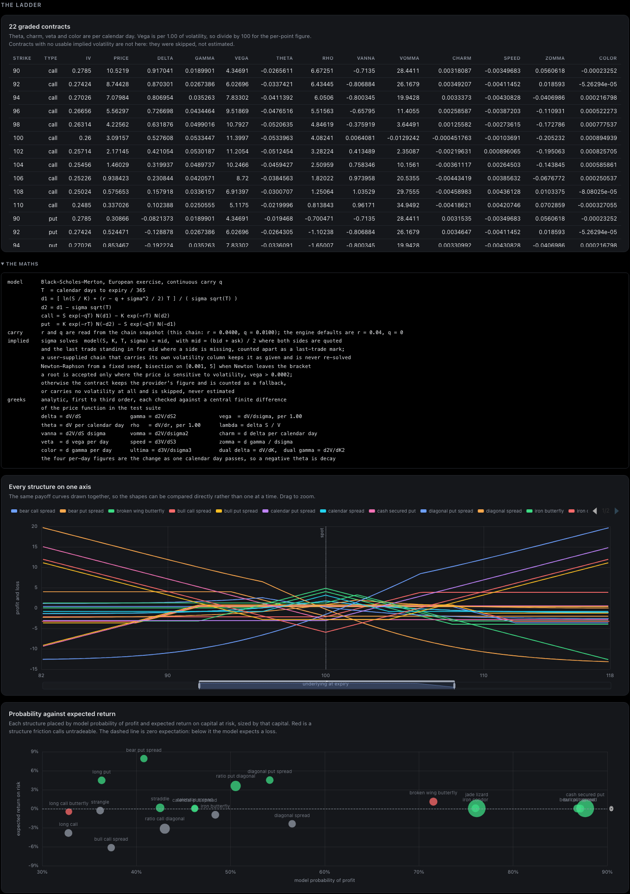
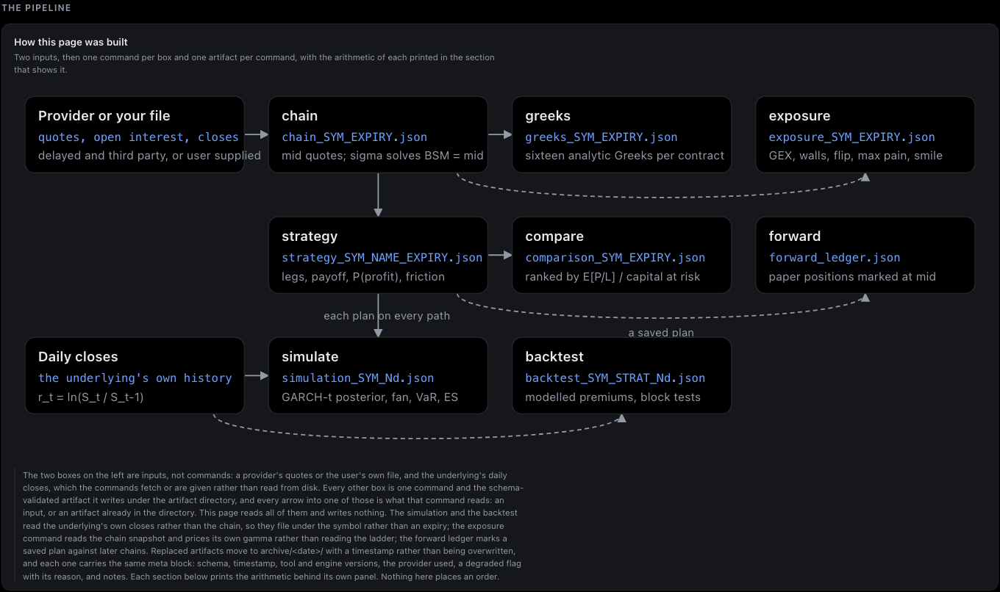

# Option Desk

Option Desk is research software for listed options.
From an option-chain snapshot, supplied by a data provider or as a CSV or JSON file, it computes Black-Scholes-Merton prices, implied volatilities and sixteen analytic Greeks per contract.
For each expiry it computes dealer gamma exposure, max pain and smile statistics.
For each of twenty-three multi-leg structures it computes the expiry payoff, the breakevens, a lognormal probability of profit and a composite score.
From a history of daily closes it fits a GARCH(1,1) model with Student-t innovations by Markov chain Monte Carlo, simulates the posterior predictive distribution, and backtests a structure with block-based permutation and bootstrap statistics.
Each result is a JSON artifact, validated against a schema, that records its source, its timestamp, its missing inputs and a `degraded` flag.
A command line, a local dashboard, MCP tools and agent skills read the same artifacts.
Premiums are model values under European exercise. The software places no orders and gives no investment advice.

[](https://github.com/Iman/agent-driven-options-desk-and-skills/actions/workflows/refresh.yml) [](docs/TESTING.md) [](docs/TESTING.md#run-the-80-unit-coverage-gate) [](INSTALL.md) [](LICENSE) [](https://registry.modelcontextprotocol.io/v0/servers?search=com.avidquant/optiondesk)

## Contents

- [See the desk](#see-the-desk)
- [Get started](#get-started)
- [Use with an agent](#use-with-an-agent)
- [Research workflow](#research-workflow)
- [Methods](#methods)
- [Design rationale](#design-rationale)
- [Evidence](#evidence)
- [Limitations](#limitations)
- [Where the desk is listed](#where-the-desk-is-listed)
- [Development](#development)
- [Documentation](#documentation)
- [Licensing](#licensing)

Guides: [Install](INSTALL.md) · [User guide](docs/wiki/Home.md) · [Examples](docs/wiki/Examples.md) · [Install skills](docs/wiki/Skill-Installation.md) · [Architecture](docs/wiki/Architecture.md) · [Troubleshooting](docs/wiki/Troubleshooting.md) · [Wiki](https://github.com/Iman/agent-driven-options-desk-and-skills/wiki)

## See the desk

The dashboard shows the chain, the model assumptions and the research results on one page.
The images are captures of the local dashboard with synthetic teaching inputs.
They are not market observations or evidence of trading performance.
[Capture details](docs/SCREENSHOT-PROVENANCE.md) distinguish the input scenario from the capture date.



### Dashboard tour

Open an image for its full resolution.
The [complete gallery](docs/SCREENSHOTS.md) includes individual panels and charts, and the [dashboard guide](docs/wiki/Dashboard.md) explains each panel.

| Positioning | Volatility |
|---|---|
|  |  |
| Assumed dealer exposure and chain coverage. | Strikes and expiries, with missing values shown as missing. |

| Structure payoff | Two-expiry structures |
|---|---|
|  |  |
| Legs, breakevens and limits. | Valuation assumptions for the surviving leg. |

| Simulation | Backtest |
|---|---|
|  |  |
| Predictive fan with the convergence diagnostics. | Outcomes with the benchmark and the model limitations. |

| Composite comparison | Contract ladder |
|---|---|
|  |  |
| The score formula and the disagreements between models. | Sensitivities and payoff shapes. |



## Get started

Choose one route:

| Starting point | First action | Continue with |
|---|---|---|
| No data account | Run the supplied sample below. | [First walkthrough](docs/wiki/Getting-Started.md) |
| Claude Code or Codex | Install the local tools, then connect the plugin. | [Agent workflows](docs/wiki/Agent-Workflows.md) |
| A CSV or JSON chain | Import it with its source and timestamp. | [Data import](docs/wiki/Importing-Data.md) |
| A browser only | Open the [hosted sample](https://optiondesk.avidquant.com). | [Hosted connection](docs/wiki/Agent-Workflows.md#browser-agents-and-the-hosted-service) |

### Try the supplied sample

The sample requires Git and Python 3.11 or later.
Run these commands on macOS or Linux:

```sh
git clone https://github.com/Iman/agent-driven-options-desk-and-skills.git
cd agent-driven-options-desk-and-skills
python3 -m venv .venv
. .venv/bin/activate
python -m pip install -e ./engine -e ./shell
optiondesk chain SYNTH --from-file examples/chain-synth.json --accept-data-rights --out-dir artifacts/tutorial
optiondesk greeks --out-dir artifacts/tutorial
optiondesk exposure --out-dir artifacts/tutorial
optiondesk compare --out-dir artifacts/tutorial
optiondesk dashboard --out-dir artifacts/tutorial
```

Open **http://127.0.0.1:8787** on the same computer.
Select **SYNTH** and **2026-10-08**.
Press `Ctrl+C` in the terminal to stop the server. The result files remain in `artifacts/tutorial`.

The supplied sample contains 62 synthetic contracts and a fixed valuation scenario.
It needs no external provider after installation.
The [walkthrough](docs/wiki/Getting-Started.md) includes Windows activation, expected results and the next steps.
[Sample provenance](examples/README.md) explains the inputs.

### Install the full local desk

From a checkout, run:

```sh
./install.sh
optiondesk doctor
```

The installer adds the local tools and skills and attempts MCP registration with each supported runtime CLI that it finds.
[Installation](INSTALL.md) covers paths, flags, Docker and removal.
A plugin installation alone does not install the local calculation engine.

For an existing local provider setup, run the complete demonstration:

```sh
./run.sh --symbols SPY
```

The runner retrieves data, builds the research artifacts, opens a paper position and serves the dashboard.
It writes to `~/TradingDesk/option-desk-demo` by default.
Use `--dry-run` to inspect its commands.
Read [provider setup](docs/wiki/Installation.md#local-provider-demo) before enabling Yahoo access.

## Use with an agent

The [skill installation guide](docs/wiki/Skill-Installation.md) gives the commands for [Codex](docs/wiki/Skill-Installation.md#codex), [Claude Code](docs/wiki/Skill-Installation.md#claude-code), [ChatGPT](docs/wiki/Skill-Installation.md#chatgpt) and [Claude chat](docs/wiki/Skill-Installation.md#claude-chat).
Codex and Claude Code accept `npx`, a manual copy, the shell installer or the plugin.
ChatGPT and Claude chat accept individual hosted-skill uploads and a separate MCP connection.

After connecting the local tools, send this request:

```text
Use examples/chain-synth.json, the supplied synthetic teaching sample.
I can use this file for private analysis.
Save the results under artifacts/tutorial.
Show its Greeks and positioning, then compare an iron condor with a straddle.
State the source, missing inputs, model assumptions, and degradation first.
```

| Task | Skill | Example request |
|---|---|---|
| Working tools | `desk-setup` | Check why my MCP tools are unavailable. |
| Contract sensitivities | `options-greeks` | Show delta, gamma, theta, and vega from this chain. |
| Chain positioning | `options-positioning` | Show the gamma walls and state the dealer-sign assumption. |
| Multi-leg structures | `options-strategy` | Compare these structures by payoff, loss, and Greeks. |
| Forward distribution | `options-simulation` | Simulate the underlying from permitted history and report convergence. |
| Historical research | `options-backtest` | Backtest this structure and explain the benchmark and missing costs. |
| American or European price | `options-pricing` | Price this put with American exercise through QuantLib. |
| LEAN handoff | `options-lean` | Export these legs to a LEAN bundle. |

See [agent setup and prompts](docs/wiki/Agent-Workflows.md).

### Use the MCP server

Two MCP servers exist. The hosted server needs no installation and works on a synthetic sample or a permitted snapshot. The local server runs every calculation on the user's computer.
The local and hosted plugins expose tools with the same names. Install one of them, not both.

#### Hosted server

The endpoint is `https://optiondesk.avidquant.com/mcp`. It uses Streamable HTTP and needs no sign-in.
It serves the SYNTH sample and analyses a permitted snapshot that the user supplies. It fetches no market data.
A `tools/list` request on 10 November 2026 returned 13 tools.

In Claude Code, add the endpoint directly:

```sh
claude mcp add --transport http optiondesk-hosted https://optiondesk.avidquant.com/mcp
```

Alternatively, install the hosted plugin inside Claude Code:

```text
/plugin marketplace add Iman/agent-driven-options-desk-and-skills
/plugin install option-desk-hosted@option-desk
```

For a client that reads `.mcp.json`, use this entry:

```json
{
  "mcpServers": {
    "optiondesk-hosted": {
      "type": "http",
      "url": "https://optiondesk.avidquant.com/mcp"
    }
  }
}
```

In Claude chat, open **Customize > Connectors**, select **+**, then **Add custom connector**, and enter the endpoint URL. The [Claude chat steps](docs/wiki/Skill-Installation.md#claude-chat) give the full procedure.
In ChatGPT, create a custom MCP app with the same URL where the account permits it. Follow the [ChatGPT steps](docs/wiki/Skill-Installation.md#chatgpt).
In Codex, add the endpoint with `codex mcp add optiondesk-hosted --url https://optiondesk.avidquant.com/mcp`. See also [hosted service and browser agents](INSTALL.md#6-hosted-service-and-browser-agents).

| Hosted tool | Purpose | Effect |
|---|---|---|
| `option_desk_status` | Data mode, source, refresh time and licence gate. | Read-only |
| `option_snapshot_schema` | Accepted CSV and JSON fields, repair rules, size limits and retention policy. | Read-only |
| `option_chain_snapshot` | Summary of SYNTH or of a supplied chain. | Read-only |
| `option_positioning` | Gamma walls, gamma flip and max pain. | Read-only |
| `option_plots` | Market and Greek plots as PNG images. | Read-only |
| `option_strategy_plot` | Payoff plot of one structure on the SYNTH chain. | Read-only |
| `option_report_plots` | Market map, Greek ladder, comparison and up to three payoff charts in one result. | Read-only |
| `option_validate_snapshot` | Validation and normalisation of a supplied snapshot. | Read-only |
| `option_plots_from_snapshot` | Market and Greek plots from a supplied snapshot. | Read-only |
| `option_strategy_from_snapshot` | One structure and its payoff plot from a supplied chain. | Read-only |
| `option_import_snapshot` | Import of a supplied chain into a private dashboard. | Writes temporary state, deleted after one hour |
| `option_private_dashboard` | Private interactive dashboard from supplied data. | Writes temporary state, expires after one hour |
| `option_delete_snapshot` | Deletion of an imported dashboard before its expiry. | Deletes temporary state |

#### Local server

The installation provides the executable `optiondesk-mcp`, which serves the protocol over stdio.
`./install.sh` attempts the registration. To register the server by hand, with the executable on PATH, run the command for the client:

```sh
claude mcp add optiondesk -- optiondesk-mcp
codex mcp add optiondesk -- optiondesk-mcp
```

Restart the client and run `optiondesk doctor`.
The local plugin declares the same server but does not install it. A plugin installation alone does not install the calculation engine.

The local MCP server exposes 12 tools for the chain, analytics, plot, history and status workflow.
It also exposes `option_price` and `option_lean` for the optional QuantLib and LEAN backends.
Simulation and backtests exist only on the local server.

| Local tool | Purpose | Effect |
|---|---|---|
| `option_snapshot_schema` | Accepted CSV and JSON fields, repair policy and size limits. | Read-only |
| `option_chain_snapshot` | Option chain for one underlying and expiry, from a permitted provider or supplied data. | Writes an artifact, can contact a provider |
| `option_greeks_ladder` | Greek ladder from a saved chain. | Writes an artifact |
| `option_plots` | Market and Greek charts as PNG images. | Writes artifacts, can contact a provider |
| `option_expiries` | Expiries that a provider lists, and those already on disk. | Read-only, can contact a provider |
| `option_strategy_build` | One multi-leg structure from a chain snapshot. | Writes an artifact |
| `option_strategy_compare` | Every buildable structure from one chain, ranked. | Writes an artifact |
| `option_positioning` | Dealer gamma exposure, walls, gamma flip, max pain, put-call ratios and smile. | Writes an artifact |
| `option_simulate` | GARCH(1,1)-t posterior and forward simulation. | Writes an artifact, can contact a provider |
| `option_backtest` | A structure across recorded price history with model premiums. | Writes an artifact, can contact a provider |
| `option_forward_test` | Paper ledger with open, mark, close and status actions. | Changes the local ledger |
| `option_desk_status` | Engine, provider, artifact path and key status. | Read-only |
| `option_price` | Vanilla European or American price through QuantLib. | Read-only |
| `option_lean` | Export of fixed legs to a LEAN bundle, or import of completed results. | Writes local files |

Example requests, first for the hosted server and then for the local server:

```text
Show the SYNTH market chart and Greek ladder.
Identify the data as synthetic and explain what each chart measures.
```

```text
Show the payoff for a SYNTH iron condor.
Explain the legs, breakevens, maximum gain, and maximum loss.
```

```text
Use examples/chain-synth.json, the supplied synthetic teaching sample.
I can use this file for private analysis.
Save this walkthrough under artifacts/tutorial.
Validate the chain, calculate its Greeks and positioning, and build an iron condor.
State the source, valuation date, missing inputs, and degradation before the numbers.
Show the payoff and explain the limits of the model.
```

## Research workflow

| Step | Action | What to inspect |
|---|---|---|
| 1. Load | [Import a chain](docs/wiki/Importing-Data.md) | Source, timestamp, expiry and missing inputs. |
| 2. Inspect | Calculate Greeks and positioning. | Units, skip counts and dealer-sign assumptions. |
| 3. Compare | [Build structures](docs/wiki/Examples.md#compare-two-structures) | Legs, breakevens, maximum loss and spread costs. |
| 4. Explore time | [Compare two expiries](docs/wiki/Examples.md#compare-two-expiries) | Near-expiry valuation and scan limits. |
| 5. Research history | [Simulate or backtest](docs/wiki/Examples.md#simulate-a-real-underlying-locally) | Convergence, benchmarks, uncertainty and omitted costs. |
| 6. Record | [Open a paper position](docs/wiki/Examples.md#open-and-mark-a-paper-position) | Plan, thesis, later marks and unavailable quotes. |

The dashboard reads saved artifacts. It does not fetch new data when the page opens.
Use the same `--out-dir` for related commands and the dashboard.
The [results guide](docs/wiki/Reading-Results.md) explains each stage.

## Methods

The table names each model and statistic that the engine implements.
Module paths are relative to `engine/src/optiondesk_engine/`.
The equations state what the code computes, with its units and sign conventions.

Notation: $S$ is the spot price, $K$ the strike, $t$ the time to expiry in years (calendar days divided by 365), $\sigma$ the volatility per 1.00, $r$ the continuously compounded rate, $q$ the continuous dividend yield, $N$ the standard normal distribution function and $\varphi$ its density.

| Model or statistic | Formula | Source module | Reference |
|---|---|---|---|
| Black-Scholes-Merton price, European exercise | Eq. 1 | `pricing/black_scholes.py` | none cited |
| Sixteen analytic Greeks | Eq. 2 | `pricing/greeks_full.py` | none cited |
| Black-76 price of an option on a future | Eq. 1 with $S = F$ and $q = r$ | `pricing/forwards.py` | Black 1976, as named in `engine/tests/test_forwards.py` |
| Garman-Kohlhagen price of a currency option | Eq. 1 with $q$ set to the foreign rate | `pricing/forwards.py` | Garman and Kohlhagen 1983, as named in `engine/tests/test_forwards.py` |
| Implied volatility by Newton-Raphson with a bisection fallback and an identification test | Eq. 3 | `pricing/black_scholes.py` | none cited |
| American and European price by finite differences (optional backend) | QuantLib engines on 400 by 400 and 800 by 800 grids | `pricing/quantlib_backend.py` | QuantLib, see [THIRD-PARTY.md](THIRD-PARTY.md) |
| Dealer gamma exposure, walls and gamma flip | Eq. 4 | `analytics/exposure.py` | none cited |
| Max pain | Eq. 5 | `analytics/exposure.py` | none cited |
| Smile statistics and expected move | Eq. 6 | `analytics/smile.py` | none cited |
| Expiry payoff, breakevens, maximum gain and loss | Eq. 7 | `strategies/payoff.py` | none cited |
| Lognormal probability of profit, expected profit and expected loss | Eq. 8 | `strategies/payoff.py` | none cited |
| Round-trip friction estimate | Eq. 9 | `strategies/friction.py` | none cited |
| Ranking criterion and composite score | Eq. 10 | `analytics/compare.py`, `analytics/ranking.py` | none cited |
| GARCH(1,1) with standardised Student-t innovations | Eq. 11 | `simulation/garch.py` | none cited |
| Posterior sampling by adaptive coordinate-wise random-walk Metropolis, split R-hat and effective sample size | Eq. 12 | `simulation/garch.py` | none cited |
| Posterior predictive paths, value at risk and expected shortfall | Eq. 13 | `simulation/paths.py` | none cited |
| Backtest with trailing realised volatility and model premiums | Eq. 14 | `backtest/runner.py` | none cited |
| Per-trade statistics in risk units | Eq. 15 | `backtest/stats.py` | none cited |
| Block sign-flip permutation p-value | Eq. 16 | `backtest/stats.py` | none cited |
| Moving-block bootstrap interval for the mean | Eq. 17 | `backtest/stats.py` | none cited |

The repository cites no publication for the rows marked "none cited".
[THIRD-PARTY.md](THIRD-PARTY.md) records the lineage of the code.

**Eq. 1, price.** The call value $C$ and put value $P$ are floored at zero.

$$
d_1 = \frac{\ln(S/K) + (r - q + \sigma^2/2) t}{\sigma \sqrt{t}}, \qquad d_2 = d_1 - \sigma \sqrt{t}
$$

$$
C = S e^{-qt} N(d_1) - K e^{-rt} N(d_2), \qquad P = K e^{-rt} N(-d_2) - S e^{-qt} N(-d_1)
$$

**Eq. 2, Greeks.** $V$ is the price and $\nu_V$ is vega per 1.00 of volatility.
Theta, charm, veta and color are changes per calendar day, so each annual derivative is divided by 365.
The first block gives the call. For the put, delta is $e^{-qt}(N(d_1) - 1)$, rho is $-K t e^{-rt} N(-d_2)$ and dual delta is $e^{-rt} N(-d_2)$.

$$
\begin{aligned}
\Delta &= e^{-qt} N(d_1) \\
\Theta &= \frac{1}{365} \left[ -\frac{S e^{-qt} \varphi(d_1) \sigma}{2 \sqrt{t}} + q S e^{-qt} N(d_1) - r K e^{-rt} N(d_2) \right] \\
\rho &= K t e^{-rt} N(d_2) \\
\text{charm} &= \frac{1}{365} \left[ q e^{-qt} N(d_1) - e^{-qt} \varphi(d_1) \left( \frac{r - q}{\sigma \sqrt{t}} - \frac{d_2}{2t} \right) \right] \\
\text{dual delta} &= -e^{-rt} N(d_2)
\end{aligned}
$$

For the put, the last two terms of theta become $-q S e^{-qt} N(-d_1) + r K e^{-rt} N(-d_2)$, and the first term of charm becomes $-q e^{-qt} N(-d_1)$.
The remaining Greeks are the same for calls and puts.

$$
\begin{aligned}
\Gamma &= \frac{e^{-qt} \varphi(d_1)}{S \sigma \sqrt{t}} \\
\nu_V &= S e^{-qt} \varphi(d_1) \sqrt{t} \\
\lambda &= \Delta S / V \\
\text{vanna} &= -e^{-qt} \varphi(d_1) d_2 / \sigma \\
\text{vomma} &= \nu_V d_1 d_2 / \sigma \\
\text{veta} &= \frac{\nu_V}{365} \left[ q + \frac{(r - q) d_1}{\sigma \sqrt{t}} - \frac{1 + d_1 d_2}{2t} \right] \\
\text{speed} &= -\frac{\Gamma}{S} \left( \frac{d_1}{\sigma \sqrt{t}} + 1 \right) \\
\text{zomma} &= \Gamma (d_1 d_2 - 1) / \sigma \\
\text{color} &= \frac{\Gamma}{365} \left[ q + \frac{(r - q) d_1}{\sigma \sqrt{t}} + \frac{1 - d_1 d_2}{2t} \right] \\
\text{ultima} &= -\frac{\nu_V}{\sigma^2} \left[ d_1 d_2 (1 - d_1 d_2) + d_1^2 + d_2^2 \right] \\
\text{dual gamma} &= \frac{e^{-rt} \varphi(d_2)}{K \sigma \sqrt{t}}
\end{aligned}
$$

Elasticity $\lambda$ is reported as zero when the price is zero.
For Black-76 the module replaces rho with $-tV$, because only the discount factor depends on the rate when the futures price is held fixed.

**Eq. 3, implied volatility.** For a quoted price $p$, the Newton-Raphson iteration starts at 0.30 and runs for at most 60 steps.

$$
\sigma_{n+1} = \sigma_n - \frac{V(\sigma_n) - p}{\nu_V(\sigma_n)}
$$

The solver changes to bisection on $[0.001, 5.0]$ when an iterate leaves that range, when vega at the iterate is below $2 \times 10^{-4}$, or when the iterations are exhausted.
A candidate $\hat\sigma$ is accepted only if all three conditions hold, with $\tau = 10^{-6}$ and $h = 0.005$.

$$
\lvert V(\hat\sigma) - p \rvert < \tau, \qquad \nu_V(\hat\sigma) \ge \tau / h, \qquad V(\hat\sigma + h) > p + \tau \quad \text{and} \quad V(\hat\sigma - h) < p - \tau
$$

The solver returns the accepted value rounded to six decimals.
It returns no value for a price below discounted intrinsic value less $\tau$, or for a price that fails the test. A contract without a value is counted and skipped, never given a default volatility.

**Eq. 4, dealer gamma exposure.** For contract $i$ with gamma $\Gamma_i$, open interest $O_i$ and contract multiplier $M$ (100 by default), the exposure is in the quote currency per one percent move of the underlying.
The sign assumes that dealers are long calls and short puts.

$$
g_i = s_i \Gamma_i O_i M S^2 \times 0.01, \qquad s_i = +1 \text{ for a call}, \quad s_i = -1 \text{ for a put}
$$

Exposure is summed by strike and accumulated from the lowest listed strike.
The call wall is the strike with the largest call exposure, and the put wall is the strike with the most negative put exposure.
The gamma flip is the zero crossing of the cumulative profile nearest to spot, found by linear interpolation between strikes. All crossings are returned.

**Eq. 5, max pain.** Over the listed strikes $x$, the level is the strike that minimises the total payout to option holders. The result is withheld when total open interest is zero.

$$
x^\ast = \arg\min_x M \left[ \sum_{i \in \text{calls}} O_i \max(x - K_i, 0) + \sum_{i \in \text{puts}} O_i \max(K_i - x, 0) \right]
$$

**Eq. 6, smile.** $\sigma_{\text{ATM}}$ is the implied volatility at the listed strike nearest to spot, not an interpolated forward value.
$\sigma_{P25}$ and $\sigma_{C25}$ are the implied volatilities of the put and the call whose absolute delta is nearest to 0.25. A wing further than 0.10 from that delta is reported as absent.

$$
\text{risk reversal} = \sigma_{P25} - \sigma_{C25}, \qquad \text{butterfly} = \frac{\sigma_{P25} + \sigma_{C25}}{2} - \sigma_{\text{ATM}}, \qquad \text{expected move} = S \sigma_{\text{ATM}} \sqrt{D / 365}
$$

$D$ is the number of calendar days to expiry.
The skew slope is the ordinary least squares slope of call implied volatility on $100 (K/S - 1)$.

**Eq. 7, expiry payoff.** Leg $j$ has side $a_j$ ($+1$ long, $-1$ short), quantity $n_j$, entry price $c_j$ and expiry value $v_j(x)$, which is $\max(x - K_j, 0)$ for a call, $\max(K_j - x, 0)$ for a put and $x$ for the underlying.

$$
\Pi(x) = \sum_j a_j n_j \left( v_j(x) - c_j \right)
$$

$\Pi$ is piecewise linear with kinks at the strikes.
Breakevens are its roots, found by linear interpolation between kinks and rounded to six decimals.
Maximum gain is infinite when the slope above the highest strike is positive, and maximum loss is infinite when that slope is negative.
Amounts are per unit of the underlying, with no contract multiplier.

**Eq. 8, lognormal settlement.** The settlement price $S_T$ follows a lognormal distribution with one volatility $\sigma$ for all strikes, drift $\mu$ (zero by default) and $T = D/365$.

$$
\ln S_T \sim \mathcal{N}\left( m, s^2 \right), \qquad m = \ln S + (\mu - \sigma^2/2) T, \qquad s = \sigma \sqrt{T}
$$

$$
\text{probability of profit} = \Pr\left[ \Pi(S_T) > 0 \right], \qquad E\left[ S_T \mathbf{1}(S_T < x) \right] = e^{m + s^2/2} N\left( \frac{\ln x - m - s^2}{s} \right)
$$

Expected profit $E[\Pi(S_T)]$ is the sum over the linear segments of $\Pi$, each evaluated in closed form with the partial expectation above.
Expected loss is $E[\Pi(S_T) \mid \Pi(S_T) < 0]$.

**Eq. 9, friction.** For option leg $j$ with a two-sided quote, the estimate uses half of the half spread on entry and on exit. The default commission is zero.

$$
\text{round trip} = 2 \sum_j n_j \cdot 0.5 \cdot \frac{\text{ask}_j - \text{bid}_j}{2}, \qquad \text{rel} = \frac{\text{round trip}}{\lvert \text{net premium} \rvert}
$$

The verdict is `ok` for $\text{rel} \le 0.10$, `thin` for $\text{rel} \le 0.25$ and `untradeable` above that.
It is also `untradeable` when a leg has no bid or quotes wider than 0.40 of its mid.
It is `unknown` when no option leg has a two-sided quote or the net premium is zero.

**Eq. 10, ranking and composite score.** The comparison orders structures by expected profit per unit of capital at risk.

$$
\text{return on risk} = \frac{E[\Pi(S_T)]}{\lvert \text{maximum loss} \rvert}
$$

A structure with an unbounded loss, no possible loss, a non-finite expectation or an `untradeable` verdict is listed as unrankable.
The composite score uses four components on $[0, 1]$.

$$
\text{score} = 100 \left( 0.30 \cdot \text{pop} + 0.30 \cdot \text{edge} + 0.25 \cdot \text{rr} + 0.15 (1 - \text{es}) \right)
$$

$$
\text{edge} = \frac{1}{2} \left[ 1 + \text{clamp}\left( \frac{E[\Pi] - \text{round trip}}{\max(\lvert \text{net premium} \rvert, 0.05)}, -1, 1 \right) \right], \qquad \text{rr} = \frac{\min(\text{reward to risk}, 3)}{3}, \qquad \text{es} = \min\left( \frac{\lvert \text{expected loss} \rvert}{\lvert \text{maximum loss} \rvert}, 1 \right)
$$

Here pop is the probability of profit, and rr is 1 for an unbounded gain.
When the maximum loss is zero, the net premium replaces it in es, and the output names the substitution.
A stated volatility view adds or subtracts 5 points, a `thin` verdict multiplies the total by 0.75, and the result is limited to $[0, 100]$.
The weights were not fitted to data.

**Eq. 11, GARCH(1,1) with Student-t innovations.** $r_k$ is the daily log return and $z_k$ is a Student-t variate with $\nu$ degrees of freedom, scaled to unit variance.

$$
r_k = \mu + e_k, \qquad e_k = \sigma_k z_k, \qquad \sigma_k^2 = \omega + \alpha e_{k-1}^2 + \beta \sigma_{k-1}^2, \qquad \sigma_0^2 = \frac{\omega}{1 - \alpha - \beta}
$$

The model requires $\omega > 0$, $\alpha \ge 0$, $\beta \ge 0$, $\alpha + \beta < 1$ and $\nu > 2$.
With $c = \sqrt{(\nu - 2)/\nu}$, the log likelihood is as follows.

$$
\ell = \sum_k \left[ \ln \Gamma\left( \frac{\nu + 1}{2} \right) - \ln \Gamma\left( \frac{\nu}{2} \right) - \frac{1}{2} \ln(\pi \nu) - \frac{1}{2} \ln \sigma_k^2 - \ln c - \frac{\nu + 1}{2} \ln\left( 1 + \frac{e_k^2}{\nu c^2 \sigma_k^2} \right) \right]
$$

**Eq. 12, sampler and diagnostics.** The sampler works in the coordinates $\mu$, $\ln \bar\sigma^2$, $\text{logit}(\alpha + \beta)$, $\text{logit}(\alpha / (\alpha + \beta))$ and $\ln(\nu - 2)$, where $\bar\sigma^2 = \omega / (1 - \alpha - \beta)$.
Each coordinate has an independent normal prior and its own normal proposal.
During burn-in, every 25 iterations the proposal scale is multiplied by 1.25 when the acceptance rate exceeds 0.44 and by 0.80 when it is below 0.20. The scales are fixed for the retained draws.
The defaults are two chains, 1,000 burn-in iterations and 3,000 retained draws per chain.

With each chain halved, $n$ draws per half, within-half variance $W$ and between-half variance $B$, split R-hat is as follows.

$$
\hat R = \sqrt{ \frac{ \frac{n-1}{n} W + \frac{1}{n} B }{ W } }
$$

The effective sample size of a chain of length $N$ sums the autocorrelations $\rho_l$ up to the first lag at which $\rho_l < 0.05$, and the smallest value across chains is reported.

$$
\text{ESS} = \frac{N}{1 + 2 \sum_l \rho_l}
$$

The posterior is marked converged only if, for every parameter, $\hat R < 1.05$ and $\text{ESS} \ge 100$, and the acceptance rate after burn-in is above zero.

**Eq. 13, predictive paths and tail risk.** Each path draws one parameter set from the posterior and its own shocks, then applies Eq. 11 to the log price for $H$ days. The default is 20,000 paths.

$$
\ln S_k = \ln S_{k-1} + \mu + \sigma_k z_k
$$

With the horizon returns $R = S_H / S_0 - 1$ sorted in ascending order as $R_{(0)} \le R_{(1)} \le \dots$ over $n$ paths, value at risk and expected shortfall at level $a$ are positive losses.

$$
j = \max\left( 0, \lfloor (1 - a) n \rfloor - 1 \right), \qquad \text{VaR}_a = -R_{(j)}, \qquad \text{ES}_a = -\frac{1}{j + 1} \sum_{i=0}^{j} R_{(i)}
$$

The fan reports the 5th, 25th, 50th, 75th and 95th percentiles per day.

**Eq. 14, backtest.** At each entry the volatility estimate is the annualised sample standard deviation of the trailing $L$ daily log returns ($L = 60$ by default).

$$
\hat\sigma = \sqrt{ 252 \cdot \frac{1}{L - 1} \sum_{k=1}^{L} (r_k - \bar r)^2 }
$$

A synthetic chain is priced with Eq. 1 at $\hat\sigma$ and $t = h / 252$, where $h$ is the holding period in trading days.
The structure is settled with Eq. 7 at the recorded close $h$ rows later.
The return of a trade is its profit divided by the absolute maximum loss, and it is undefined when the loss is unbounded.

**Eq. 15, per-trade statistics.** For per-trade returns $x_1, \dots, x_n$ with mean $\bar x$ and sample standard deviation $s_x$, the equity curve is the running sum, not a compounded product.

$$
E_k = \sum_{i \le k} x_i, \qquad \text{maximum drawdown} = \max_k \left( \max\left( 0, \max_{i \le k} E_i \right) - E_k \right), \qquad \text{Sharpe} = \frac{\bar x}{s_x} \sqrt{\frac{252}{h}}
$$

The per-trade Sharpe ratio omits the square-root factor.

**Eq. 16, permutation p-value.** Consecutive entries overlap, so one random sign is drawn for each block of $b = \max(1, \lceil h / e \rceil)$ consecutive trades, where $e$ is the entry spacing in trading days.
With $\bar x^{(m)}$ the mean after sign flip $m$, and $T = 2000$ flips, the two-sided p-value is as follows.

$$
p = \frac{1 + G}{T + 1}
$$

$G$ is the number of sign flips $m$ for which $\lvert \bar x^{(m)} \rvert \ge \lvert \bar x \rvert$.

**Eq. 17, bootstrap interval.** A moving-block bootstrap draws blocks of $b$ consecutive trades with replacement until $n$ returns are collected, 2,000 times.
The 90 percent interval is the pair of order statistics of the resampled means at ranks $\lfloor 0.05 (T - 1) \rfloor$ and $\lfloor 0.95 (T - 1) \rfloor$, counted from zero.

## Design rationale

Each row cites the measurement recorded beside the code that it describes.

| Choice | Alternative replaced | Reason with evidence |
|---|---|---|
| The implied-volatility solver accepts a value only when a step of 0.005 in either direction moves the model price outside the tolerance (Eq. 3). | Acceptance of any volatility that reprices the quote within tolerance. | On a grid of 1,440 contracts, 43 priced within $10^{-6}$ of the intrinsic floor returned values 0.001 to 0.07 above the true volatility. The worst case returned 0.117513 for a true value of 0.05. Source: comment at `MIN_VEGA` in `pricing/black_scholes.py`. |
| Low vega at a Newton iterate sends the solve to bisection. | Refusal of the contract at that iterate. | On one SPY chain, 41 of 56 refusals were solvable by bisection to better than $10^{-5}$ in volatility. Source: comment in `implied_vol`, `pricing/black_scholes.py`. |
| The sampler uses the unconditional variance, the persistence and the ARCH share as coordinates. | Direct sampling of $\omega$, $\alpha$ and $\beta$. | The effective sample size on $\omega$, $\alpha$ and $\beta$ rose by a factor of 10 to 17, and the correlation between the two sampled variance coordinates changed from -0.84 to +0.67. Source: comment above `_to_unconstrained` in `simulation/garch.py`. |
| Predictive paths are independent, with one posterior draw per path. | Antithetic pairs. | Of 10,000 pairs none shared a shock sequence, and the correlation between pair members was -0.016 where a working mirror gives -1. Source: module docstring of `simulation/paths.py`. |
| The permutation test and the bootstrap operate on blocks of overlapping trades (Eq. 16, Eq. 17). | Independent sign flips and resampling per trade. | For a 30-day hold entered every five trading days, the effective sample was 64 to 88, not 233. Standard errors were understated by a factor of 1.6 to 1.9, and one p-value moved from 0.0005 to 0.068. Source: docstring of `permutation_p_value` in `backtest/stats.py`. |
| The backtest prices its synthetic chain over $h / 252$ years. | Pricing over $h / 365$ years for a holding period counted in trading days. | An at-the-money straddle at 18 percent volatility priced 4.1186 at 30/365 against 4.9573 at 30/252, so entry premiums were about 17 percent low. Source: docstring of `synthetic_chain` in `backtest/runner.py`. |

## Evidence

| Item | Value | Source |
|---|---|---|
| Tests collected | 1144 in total (399 engine, 584 shell, 161 agent) | `pytest --collect-only`, checked by `shell/tests/test_documented_counts.py` |
| Unit coverage gate | 80% line coverage for each of the three packages | `scripts/check_unit_coverage.py`, [Testing and coverage](docs/TESTING.md) |
| Mutation cases | 99 defined | `scripts/mutate.py` |
| CI matrix | Python 3.11 and 3.13 | [refresh workflow](.github/workflows/refresh.yml) |
| Artifact contracts | 8 schemas + validator | `shell/src/optiondesk/contracts/` |

The test figures are collection counts measured on 10 November 2026. They do not state that every test ran for this revision.
The Checks badge links to the CI result.

The numerical checks are in the engine suite.
`engine/tests/test_greeks_full.py` compares each analytic Greek with a central finite difference of the price function in Eq. 1.
`engine/tests/test_forwards.py` compares the Black-76 and Garman-Kohlhagen prices with closed forms written out independently of the module.
`engine/tests/test_ranking.py` compares the composite score with a value computed by hand.
[research/backend-evaluation/README.md](research/backend-evaluation/README.md) records a comparison of the pricer with QuantLib on synthetic cases, with its limits.

The [evidence record](docs/evidence.json) fixes an earlier chain measurement at `2026-08-30T14:12:17+00:00`.
It records `607 contracts, spot, listed expiries` and `595 solved, 12 refused as unidentified`.
These are historical evidence strings. They are not counts for the supplied sample or for the screenshots.
`scripts/evidence.py check` compares them with the record on each refresh.

## Limitations

- The software places no orders and has no broker integration. The paper ledger records local plans, marks and settlements only.
- Results are not investment advice. A ranking is an ordering under stated assumptions, not a recommendation or an estimate of edge.
- Option premiums are model values. They are not quotes, fills or achievable prices.
- The default engine assumes European exercise. Chain Greeks and strategy premiums are not American-option sensitivities, and the optional QuantLib backend does not implement discrete dividends.
- Missing inputs are not filled. A contract without an identified implied volatility receives no Greeks, and a position without a matching chain is not marked.
- The dealer sign convention in Eq. 4 is an assumption. It is often wrong for a single name, and every wall moves with it.
- Eq. 8 uses one at-the-money volatility for all strikes. A positive model expectation largely measures the difference between that volatility and the smile.
- The backtest uses recorded closes and model premiums, with no spread, slippage, assignment or early exercise. Entry and exit use the same model, so the backtest cannot detect an edge that comes from market prices differing from that model.
- A p-value applies to a hypothesis chosen before the data were seen. The block sign-flip test assumes symmetry under the allowed flips, and a bootstrap with one available block returns a zero-width interval.
- Simulation quantiles from a posterior with `converged: false` are written but are not reliable estimates. The effective sample size estimator truncates its autocorrelation sum and overstates for chains that mix badly.
- The simulation evaluates a structure at its intrinsic payoff at the requested horizon. It does not align plan expiries or keep the time value of a far leg.
- No supplied provider carries option chains for futures or foreign exchange, so the Black-76 and Garman-Kohlhagen functions price only quotes that the user supplies.
- The hosted service supports snapshot validation, Greeks, positioning and strategy plots. It does not fetch live market data.

[DISCLAIMER.md](DISCLAIMER.md) holds the terms of use. [Capabilities](docs/CAPABILITIES.md#numerical-interpretation-limits) and the [master algorithm](docs/wiki/Algorithm.md#numerical-and-inference-limits) list the numerical limits in full.

## Where the desk is listed

The listed pages answered on 10 November 2026.

| Listing | Link | Status |
|---|---|---|
| Official MCP Registry | [com.avidquant/optiondesk](https://registry.modelcontextprotocol.io/v0/servers?search=com.avidquant/optiondesk) | Version 0.3.0, published 11 September 2026. Remote entry for the hosted endpoint, domain verified. |
| Glama server | [Iman/agent-driven-options-desk-and-skills](https://glama.ai/mcp/servers/Iman/agent-driven-options-desk-and-skills) | Indexed from the repository. |
| Glama connector | [com.avidquant.optiondesk/option-desk](https://glama.ai/mcp/connectors/com.avidquant.optiondesk/option-desk) | Hosted endpoint, 13 tools. |
| Claude Code and Codex marketplaces | This repository: `/plugin marketplace add Iman/agent-driven-options-desk-and-skills` | Local plugin `option-desk` and hosted plugin `option-desk-hosted`. |
| Hosted sample | [optiondesk.avidquant.com](https://optiondesk.avidquant.com), MCP at `/mcp` | Synthetic SYNTH data, no account needed. |
| LinkedIn article | [I built an options desk an agent can drive](https://www.linkedin.com/pulse/i-built-options-desk-agent-can-drive-iman-samizadeh-phd-yjhke) | Published 10 September 2026. |

Each directory maintains its own listing page. A listing describes the hosted endpoint or the repository as it was on the date shown.

## Development

Install the development dependencies and run from the repository root.
[Development](docs/wiki/Development.md) covers environment setup and screenshot capture.
[Testing and coverage](docs/TESTING.md) covers the unit, BDD, integration and validation layers and the 80% unit line-coverage gate per package.

```sh
python -m pytest engine/tests -q    # 399 tests
python -m pytest shell/tests -q     # 584 tests
python -m pytest agent/tests -q     # 161 tests
python -m pytest -q                # 1144 tests
```

```sh
python3 scripts/refresh.py --no-index
python3 scripts/mutate.py --list
```

Ten stages in a full run rebuild generated documents and packages, check recorded evidence, and run the suites and repository rules.
The mutation harness defines ninety-nine mutations. Its output separates detected changes, survivors and skipped cases.

Eight schemas under `shell/src/optiondesk/contracts/` define the artifact interface.
See [the architecture guide](docs/wiki/Architecture.md) for their roles.

[Contribute](CONTRIBUTING.md) · [Backlog](docs/BACKLOG.md) · [Changelog](CHANGELOG.md) · [Security](SECURITY.md)

## Documentation

| Guide | Purpose |
|---|---|
| [User guide home](docs/wiki/Home.md) | Tasks, each followed to a result. |
| [Installation reference](INSTALL.md) | The eight install paths for local, plugin, skills-only, hosted and container use. |
| [Dashboard tour](docs/wiki/Dashboard.md) | The panels and the missing calculations. |
| [Examples](docs/wiki/Examples.md) | Commands and expected results. |
| [Troubleshooting](docs/wiki/Troubleshooting.md) | Installation, provider, import and chart problems. |
| [FAQ](FAQ.md) | Common questions and interpretation limits. |
| [Capabilities](docs/CAPABILITIES.md) | Feature and interface catalogue. |
| [Master algorithm](docs/wiki/Algorithm.md) | One pseudocode reference for skills, loops, graph routing, prompts, backtests and paper tests. |
| [Architecture](docs/wiki/Architecture.md) | Packages, data flow, contracts, current diagrams and preserved design references. |
| [Preserved project reference](docs/wiki/Reference-README.md) | The complete earlier README, with its engineering detail, measurements and examples. |
| [API inventory](docs/INVENTORY.md) | Generated public function and class reference. |
| [Documentation map](docs/wiki/Documentation-Map.md) | All guides, policies and maintenance references. |

## Licensing

The repository uses [PolyForm Noncommercial 1.0.0](LICENSE).
It is source available and free for noncommercial use.
Commercial use requires a separate written agreement. See [LICENSES.md](LICENSES.md).
The software licence does not grant rights to provider data.

Read the [disclaimer](DISCLAIMER.md), [privacy policy](PRIVACY.md) and [third-party notices](THIRD-PARTY.md).
